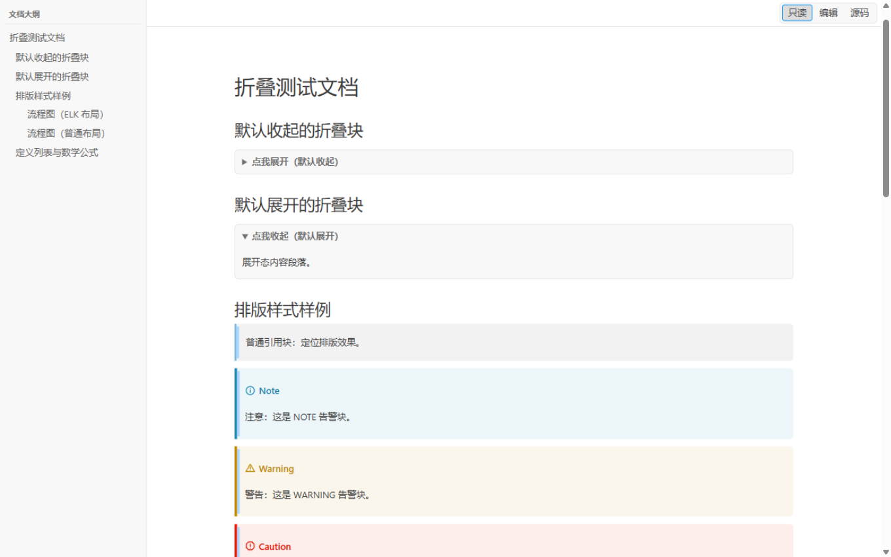
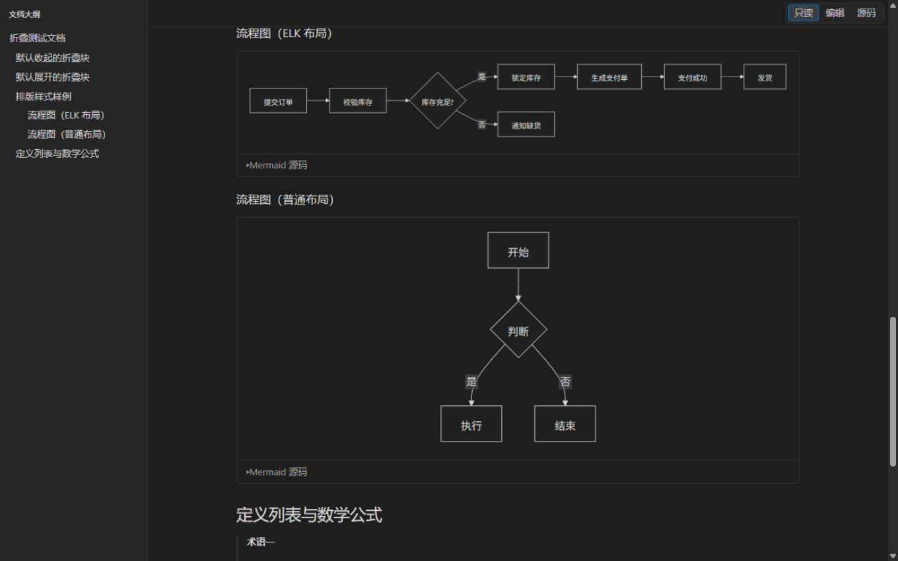
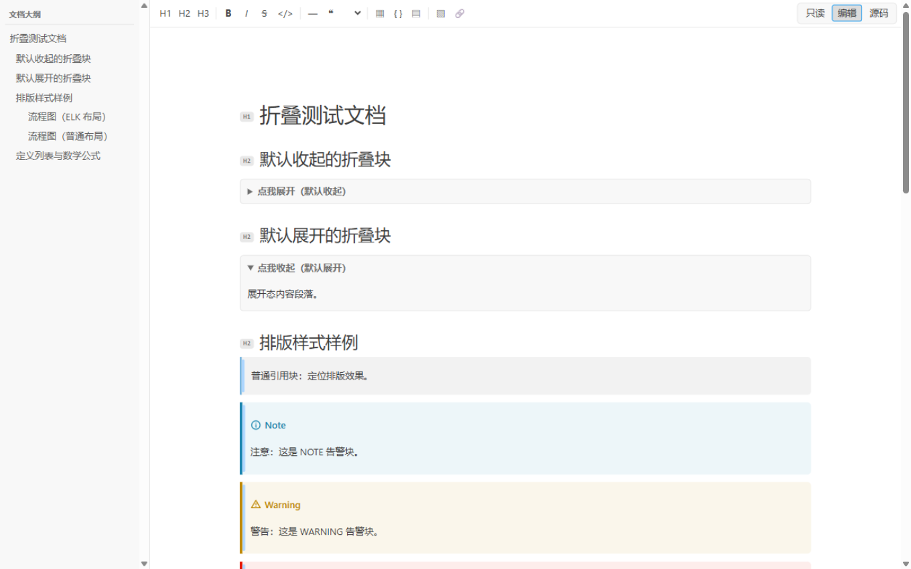
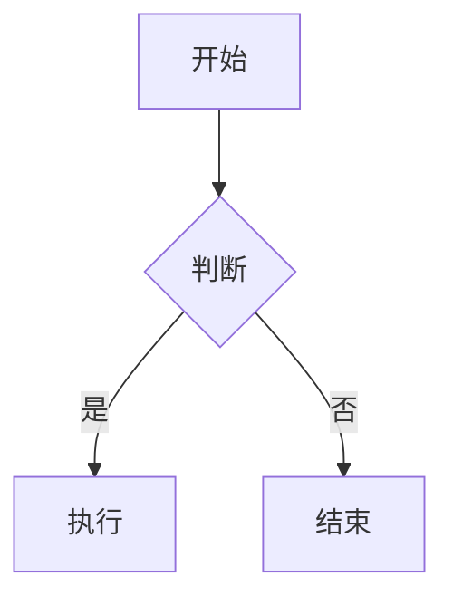
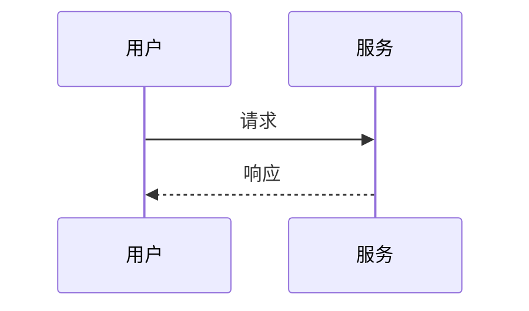
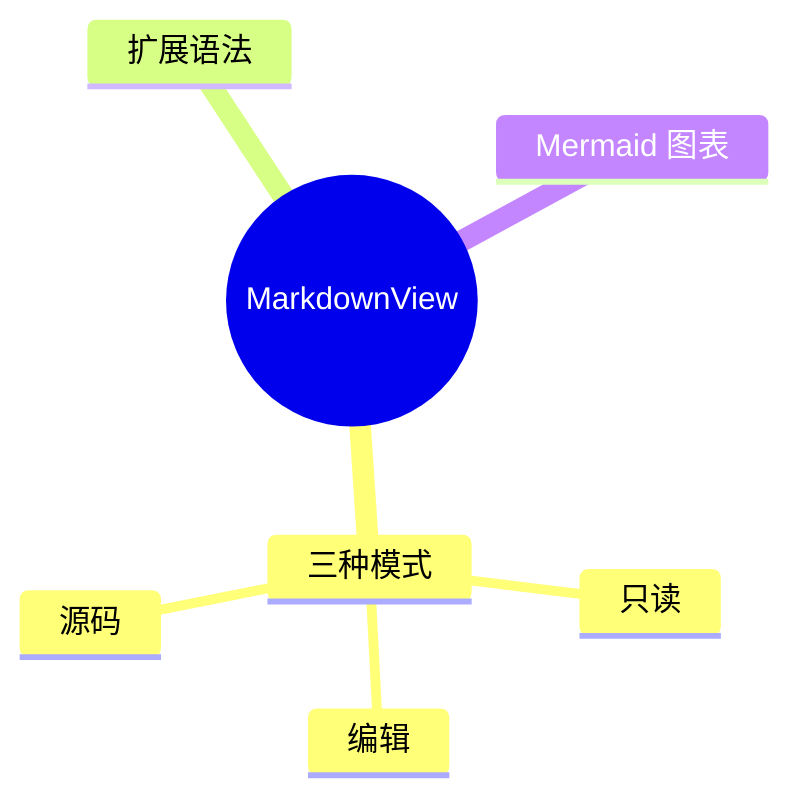
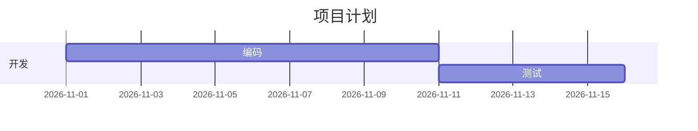

# MarkdownView

面向 VS Code 的轻量级 Markdown **所见即所得**查看与编辑插件：默认以只读画布打开 `.md` / `.markdown` 文件，顶部一键切换只读、编辑、源码三种模式；所有改动实时同步给 VS Code 文本文档，保存、未保存状态与撤销/重做均由 VS Code 接管。基于 Milkdown Crepe 单画布实现，界面完全跟随 VS Code 主题。

## 界面预览

| 只读模式 · 亮色 | 只读模式 · 暗色 |
| :---: | :---: |
|  |  |



## 功能特性

- **三态模式**：只读浏览、所见即所得编辑、源码编辑；不取代默认文本编辑器，随时可切回。
- **文档大纲**：左侧列出全部标题并可点击跳转，宽度支持拖拽与键盘调整。
- **编辑工具栏与选区工具栏**：顶部工具栏可插入标题、行内格式、引用、四种列表、表格、代码块、折叠块、图片与链接；选中文字浮现加粗/斜体/删除线/行内代码/公式/链接快捷工具栏；悬停块手柄的加号打开块插入菜单；点击链接或图片直接弹出地址修改弹窗。
- **扩展语法**：相对路径与 URL 图片、`<details>` 折叠块、GitHub 风格告警块（NOTE / TIP / IMPORTANT / WARNING / CAUTION，带图标与标题）、定义列表、行内与块级数学公式。
- **Mermaid 图表**：34 种图表类型开箱即用，支持 `flowchart-elk` ELK 布局；`usecase-beta` 用例图自动兼容转换；视口内图表即时渲染，屏外图表经全局串行队列懒加载，渲染结果按主题与源码缓存；编辑模式下点击"Mermaid 源码"展开可编辑源码面板，渲染失败保留上一次结果并显示原因提示。
- **主题与字号**：明暗主题与字号跟随 VS Code 设置（`markdownView.fontSize`，10–32px）。
- **可靠同步**：源码有修改时切回富文本，按安全块增量/分批解析恢复，大文档不卡顿、不跳滚动位置。

## 支持的语法

本 README 本身就是用 MarkdownView 支持的语法编写的：在插件里打开本页源文件，下面的示例会直接渲染出效果；在 GitHub 上，Mermaid、告警块、折叠块与数学公式同样会渲染。

### 基础 Markdown

标准 Markdown 全部可用：标题（H1–H6）、**加粗**、*斜体*、~~删除线~~、`行内代码`、[链接](https://code.visualstudio.com)、图片、有序/无序/任务列表、引用、表格与代码块。

````text
# 标题 1
## 标题 2

**加粗** *斜体* ~~删除线~~ `行内代码` [链接](https://example.com)

1. 有序列表
2. 有序列表

- [ ] 任务列表

| 表头 A | 表头 B |
| ------ | ------ |
| 内容   | 内容   |

> 引用内容

```js
// 代码块，支持语法高亮
console.log('Hello, MarkdownView!');
```
````

### 折叠块

使用原生 HTML `<details>` / `<summary>` 语法，内部支持全部 Markdown 内容，展开状态会写回文档：

```text
<details>
<summary>点击展开查看详情</summary>

折叠内容支持**全部 Markdown 语法**，包括代码块、列表和表格。

</details>
```

下面就是真实渲染的折叠块：

<details>
<summary>点我收起——这是一个真实渲染的折叠块</summary>

折叠内容里可以放列表、代码块：

```js
console.log('折叠块里也能放代码');
```

</details>

### 告警块

GitHub 风格的告警块，五种类型各自带图标、标题与配色：

```text
> [!NOTE]
> 提示性内容。

> [!WARNING]
> 警告内容。
```

真实渲染效果：

> [!NOTE]
> 注意：用于强调用户应该注意的信息。

> [!TIP]
> 提示：可选的、有助于更好地完成任务的信息。

> [!IMPORTANT]
> 重要：用户成功所必需的关键信息。

> [!WARNING]
> 警告：可能造成错误的紧急信息。

> [!CAUTION]
> 危险：可能导致严重后果的操作。

### 定义列表

`术语` + 冒号缩进的定义行：

```text
术语一
: 这是术语一的定义内容。

术语二
: 这是术语二的第一个定义。
: 这是术语二的第二个定义。
```

### 数学公式

支持行内公式与块级公式（KaTeX）：

- 行内：勾股定理 $a^2 + b^2 = c^2$。
- 块级：

$$
\int_{-\infty}^{\infty} e^{-x^2} \, dx = \sqrt{\pi}
$$

### Mermaid 图表

34 种图表类型，直接使用 ```mermaid 代码块编写。以下为真实渲染示例：









ELK 布局与用例图的写法（在插件内渲染）：

```text
flowchart-elk LR
    A[提交订单] --> B[校验库存]
    B --> C{库存充足?}
    C -->|是| D[锁定库存]
    C -->|否| E[通知缺货]
```

```text
usecase-beta
    actor 用户
    usecase 登录
    用户 --> 登录
```

`usecase-beta` 会自动转换为流程图渲染，文档中的原始语法保持不变。

<details>
<summary><strong>全部 34 种图表类型</strong></summary>

| 图表 | 关键字 | 图表 | 关键字 |
| --- | --- | --- | --- |
| 流程图 | `flowchart` | 流程图（ELK 布局） | `flowchart-elk` |
| 时序图 | `sequenceDiagram` | 类图 | `classDiagram` |
| 状态图 | `stateDiagram-v2` | E-R 图 | `erDiagram` |
| 脑图 | `mindmap` | 甘特图 | `gantt` |
| 饼图 | `pie` | Git 分支图 | `gitGraph` |
| 用户旅程图 | `journey` | 时间线 | `timeline` |
| 象限图 | `quadrantChart` | 需求图 | `requirementDiagram` |
| XY 图表 | `xychart-beta` | 桑基图 | `sankey-beta` |
| 雷达图 | `radar-beta` | 看板 | `kanban-beta` |
| 鱼骨图 | `ishikawa` | 矩形树图 | `treemap-beta` |
| 树状图 | `treeView-beta` | Wardley 图 | `wardley-beta` |
| 用例图 | `usecase-beta` | 事件建模图 | `eventmodeling` |
| Cynefin 图 | `cynefin-beta` | 泳道图 | `swimlane-beta` |
| 韦恩图 | `venn-beta` | 块图 | `block-beta` |
| 网络包图 | `packet-beta` | 架构图 | `architecture-beta` |
| C4 架构图 | `C4Context` | 语法图（EBNF） | `railroad-ebnf-beta` |
| 语法图（ABNF） | `railroad-abnf-beta` | 语法图（PEG） | `railroad-peg-beta` |

每种图表的完整可运行示例见 [examples/local-test.md](https://github.com/5faith/MarkdownView-Plugin/blob/vscode/examples/local-test.md)。

</details>

## 使用方式

- 右键 Markdown 文件标签页，选择 **Reopen With... / 打开方式... → MarkdownView**；或从命令面板执行 **MarkdownView: Open WYSIWYG Editor**。
- 顶部按钮切换 **只读 / 编辑 / 源码** 三种模式：只读适合浏览，编辑即所见即所得，源码直接编辑 Markdown 原文。
- 需要查看原始 Markdown 时，用 **Reopen With... → Text Editor** 切回默认文本编辑器，两种方式互不干扰。

## 设置

| 设置项 | 说明 | 默认值 |
| --- | --- | --- |
| `markdownView.fontSize` | 编辑器字号（10–32px） | `14` |

字号与明暗主题均跟随 VS Code 设置实时生效。

## 开发

```powershell
pnpm install          # 安装依赖
pnpm run check        # 类型检查
pnpm run dev          # 编译打包并安装到隔离的测试 VS Code
pnpm run package      # 生成 VSIX 安装包
```

项目结构、调试方式、浏览器 harness 与本地测试清单见 [docs/DEVELOPMENT.md](https://github.com/5faith/MarkdownView-Plugin/blob/vscode/docs/DEVELOPMENT.md)，市场发布流程见 [PUBLISH.md](https://github.com/5faith/MarkdownView-Plugin/blob/vscode/PUBLISH.md)。

## 许可证

[MIT](https://github.com/5faith/MarkdownView-Plugin/blob/vscode/LICENSE)
